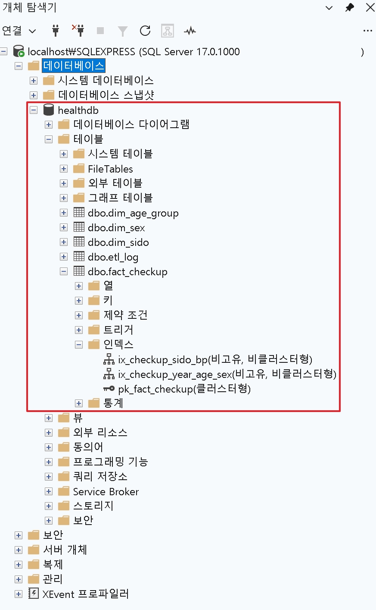
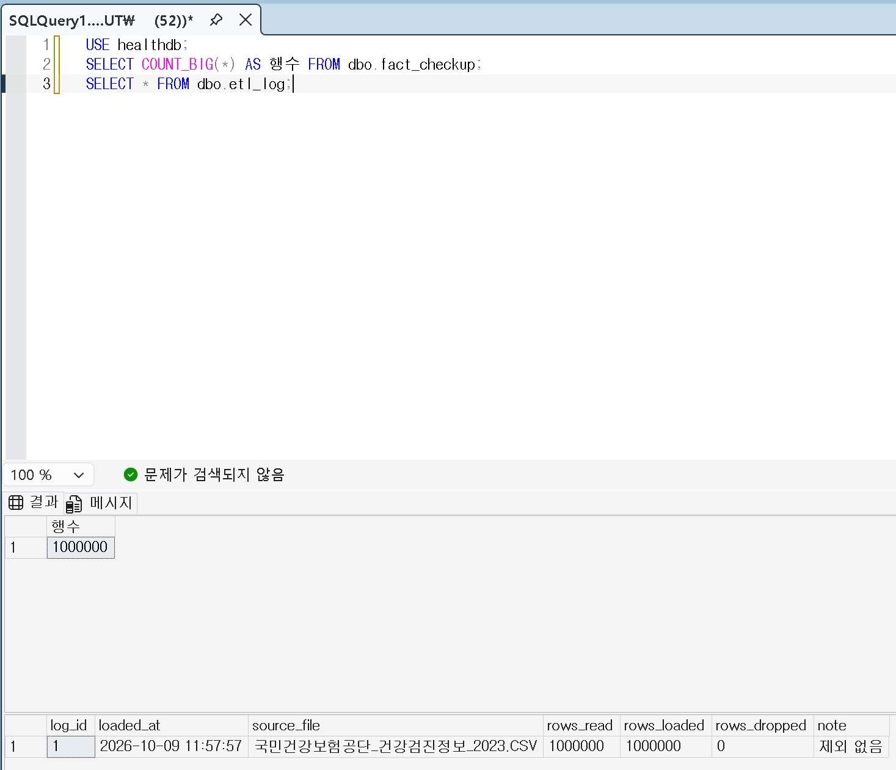
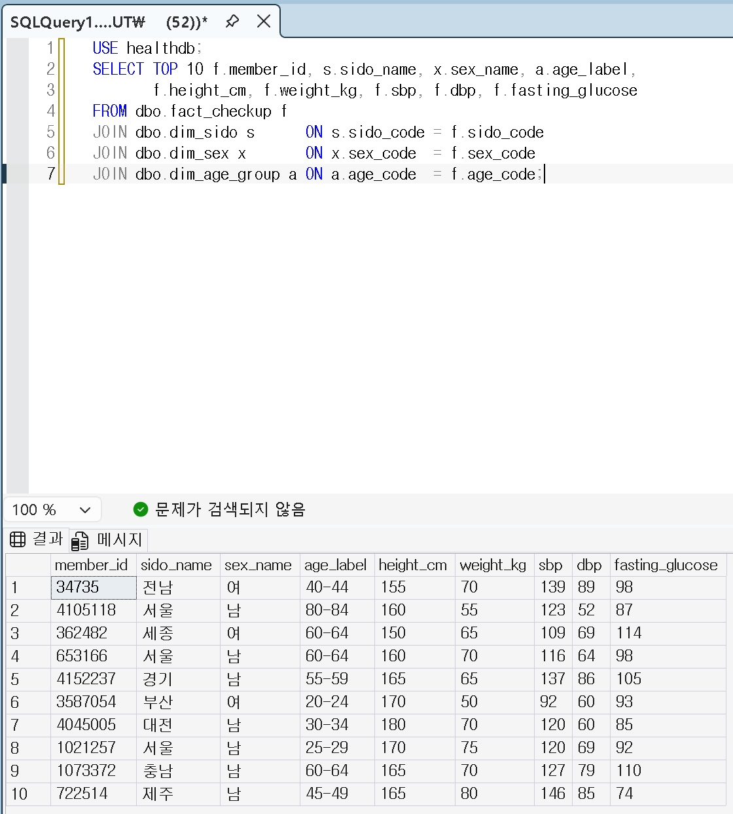
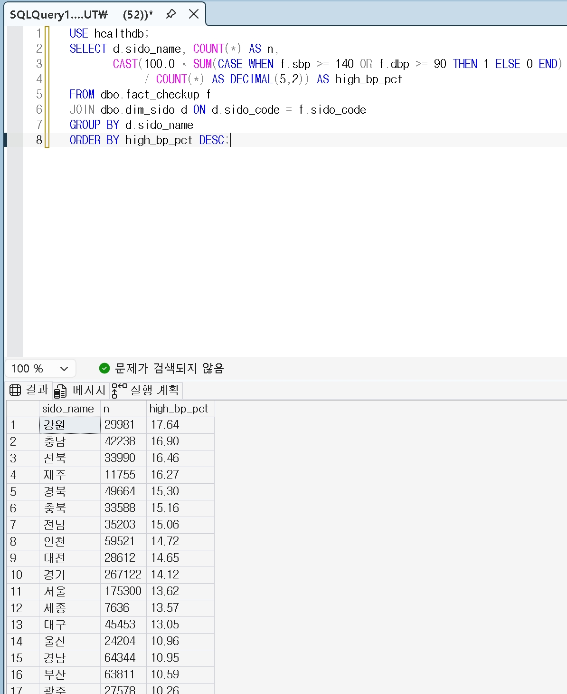
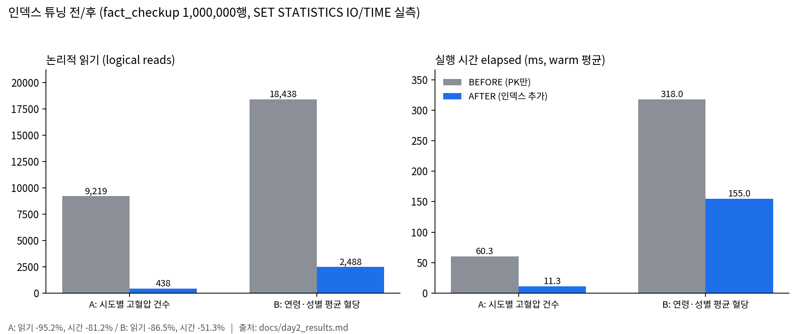
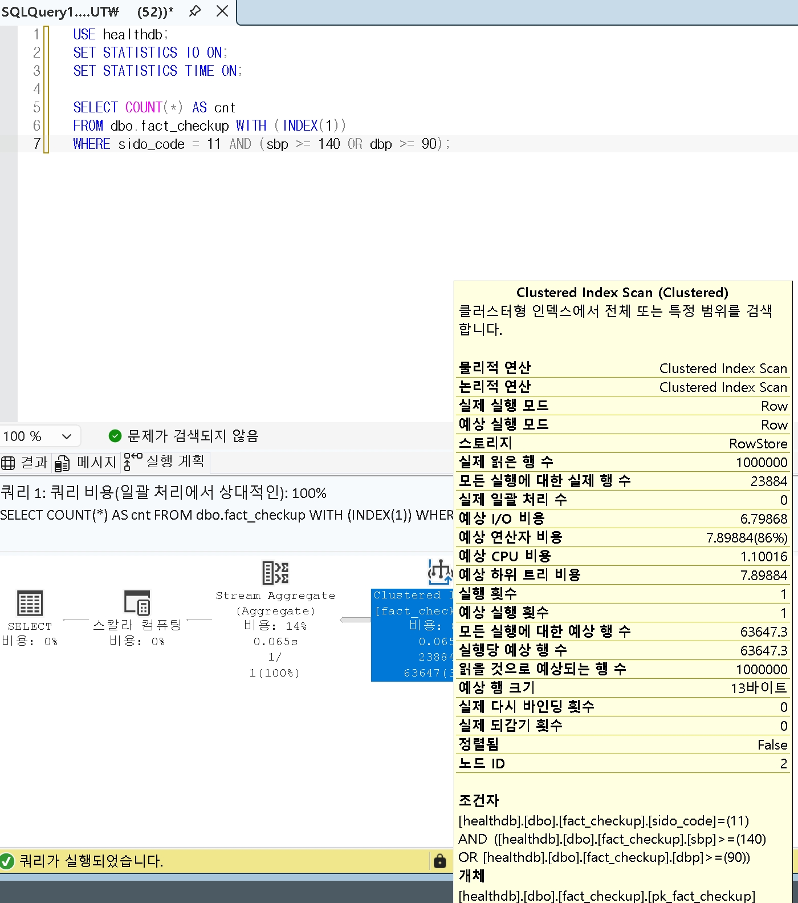
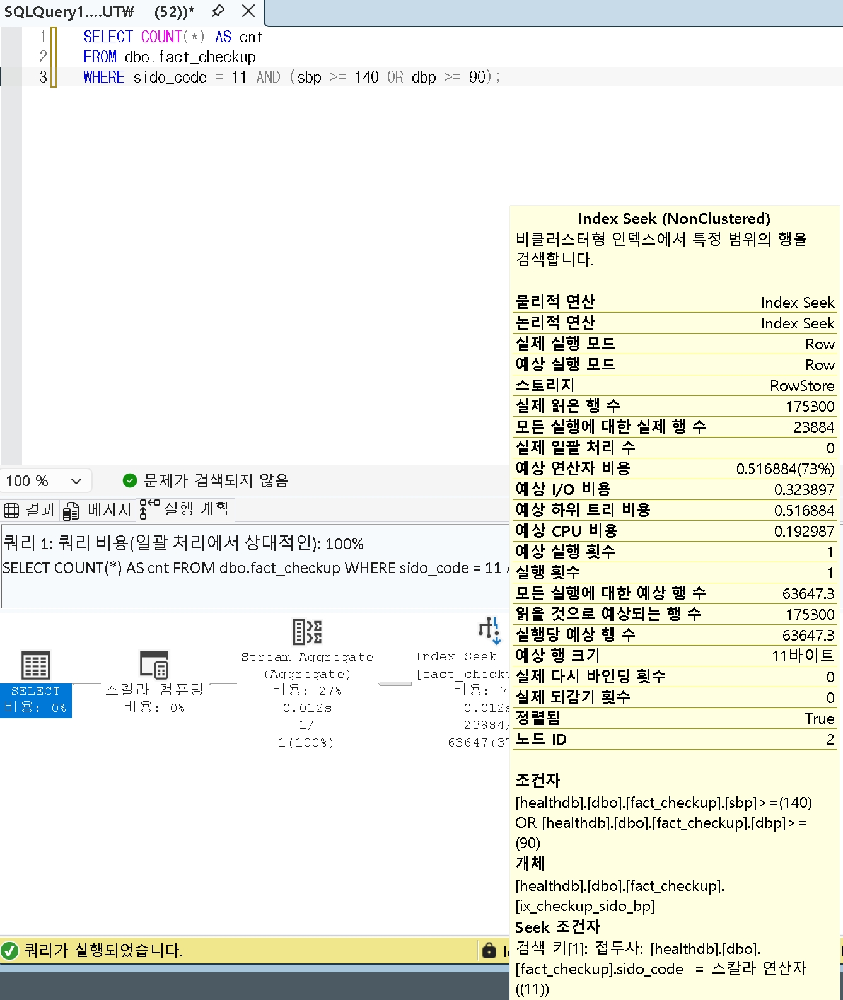
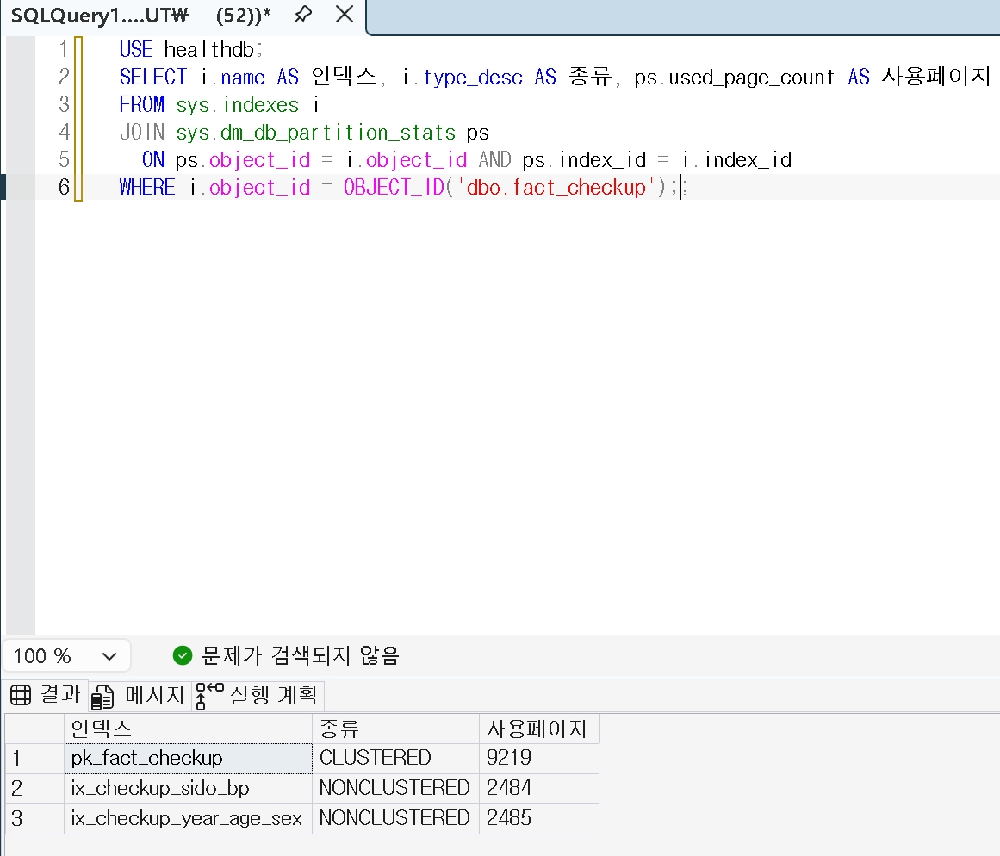
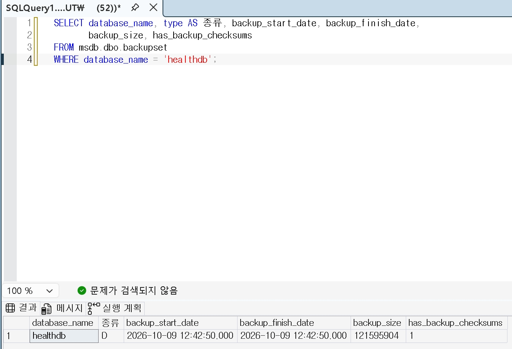

# 건강검진 공개 데이터로 만든 SQL Server 운영·튜닝 포트폴리오

국민건강보험공단 건강검진정보(2023년, 1,000,000행) CSV 를 SQL Server 에 적재하고,
**스키마 설계 → ETL 적재 → 분석 쿼리 → 인덱스 튜닝(전/후 측정) → 데이터 품질 점검 → 백업·복구 검증**까지
DB 운영 업무 흐름을 3일 동안 직접 수행한 프로젝트입니다.

> README 의 모든 수치는 `docs/` 의 측정 기록(`day2_analysis.md`, `day2_results.md`, `day3_quality.md`, `day3_backup.md`)에서 가져온 실제 실행 결과입니다. 추정치는 쓰지 않았습니다.

## 사용 기술

| 구분 | 내용 |
|---|---|
| DBMS | SQL Server 2025 Express (RTM 17.0.1000.7, 64-bit), SSMS |
| 언어 | T-SQL, Python 3.13 |
| 라이브러리 | pandas 2.3.0, pyodbc 5.3.0 |
| 연결 | ODBC Driver 18 for SQL Server, Windows 인증(`Trusted_Connection=yes`) — 비밀번호를 쓰지 않음 |
| 환경 | Windows 11, 단일 PC |

## 데이터 출처

- 국민건강보험공단 건강검진정보 2023년 (공공데이터포털), 1,000,000행 × 33컬럼, 인코딩 cp949
- 개인을 식별할 수 있는 정보는 없고(공공데이터포털 설명 기준), 가입자 일련번호는 식별 불가 번호입니다.
- **원본 CSV 는 이 저장소에 포함하지 않았습니다** (`data/` 는 `.gitignore` 처리). 직접 내려받아 `data/` 에 두고 실행하세요.
- **데이터 이용 조건(라이선스·출처 표시 등)은 공공데이터포털의 해당 데이터 페이지에서 직접 확인해야 합니다.**

## 폴더 구조와 실행 순서

```
medi_Project/
├─ data/                      원본 CSV (저장소 미포함)
├─ sql/
│  ├─ 01_schema.sql           DB·테이블 생성 + 코드표 입력
│  ├─ 03_analysis.sql         분석 쿼리 Q1~Q6b
│  ├─ 04_tuning.sql           인덱스 튜닝 전/후 측정 쿼리와 인덱스 정의
│  ├─ 05_quality_checks.sql   데이터 품질 점검 (+ 보충 점검)
│  └─ 06_backup.sql           전체 백업, 검증, 복구 연습
├─ etl/02_load.py             CSV → fact_checkup 적재
├─ tools/measure_tuning.py    04의 측정을 자동화 (STATISTICS IO/TIME + 실행 계획 → JSON)
└─ docs/
   ├─ day2_analysis.md        분석 쿼리 실행 결과
   ├─ day2_results.md         튜닝 전/후 측정 기록
   ├─ day3_quality.md         품질 점검 결과
   └─ day3_backup.md          백업·복구 결과
```

| 순서 | 실행 | 비고 |
|---|---|---|
| 1 | `sql/01_schema.sql` (SSMS) | ⚠️ 재실행하면 기존 테이블을 DROP 후 다시 만듭니다. 적재 후에는 다시 실행하지 마세요. |
| 2 | `python etl/02_load.py "data/<CSV 파일명>"` | 서버/DB 는 환경변수 `MSSQL_SERVER`, `MSSQL_DB` 로 바꿀 수 있음 (기본 `localhost\SQLEXPRESS`, `healthdb`) |
| 3 | `sql/03_analysis.sql` | 분석 쿼리 |
| 4 | `sql/04_tuning.sql` 또는 `python tools/measure_tuning.py <phase> <out.json>` | ⚠️ `DBCC DROPCLEANBUFFERS` 포함 — 개발 PC 전용, 운영 서버 금지 |
| 5 | `sql/05_quality_checks.sql` | |
| 6 | `sql/06_backup.sql` | 백업 경로는 `SERVERPROPERTY('InstanceDefaultBackupPath')` 로 구함 |

## ERD

```
dim_sido                 dim_sex                  dim_age_group
─────────────────        ─────────────────        ─────────────────────
PK sido_code SMALLINT    PK sex_code TINYINT      PK age_code TINYINT
   sido_name NVARCHAR(20)   sex_name NVARCHAR(10)    age_label NVARCHAR(20)
   (17행)                   (2행)                    (18행, 5세 단위)
        │ 1                      │ 1                       │ 1
        │                        │                         │
        │ N                      │ N                       │ N
        └──────────────┬─────────┴──────────┬──────────────┘
                       ▼                    ▼
fact_checkup (1,000,000행)
──────────────────────────────────────────────────────────────
PK checkup_id      BIGINT IDENTITY  (CLUSTERED)
   base_year       SMALLINT  NOT NULL
   member_id       BIGINT    NOT NULL   가입자 일련번호(식별 불가)
FK sido_code       SMALLINT  NOT NULL → dim_sido
FK sex_code        TINYINT   NOT NULL → dim_sex
FK age_code        TINYINT   NOT NULL → dim_age_group
   height_cm, weight_kg, sbp, dbp, fasting_glucose, total_chol,
   triglyceride, hdl, ldl, ast, alt, gamma_gtp        SMALLINT NULL
   waist_cm DECIMAL(5,1), hemoglobin DECIMAL(4,1), creatinine DECIMAL(4,1)  NULL
   smoking_status, drinking_yn                         TINYINT NULL
IX ix_checkup_sido_bp       (sido_code) INCLUDE (sbp, dbp)
IX ix_checkup_year_age_sex  (base_year, age_code, sex_code) INCLUDE (fasting_glucose)

etl_log (적재 이력, FK 없음)
──────────────────────────────────────────────────────────────
PK log_id INT IDENTITY
   loaded_at DATETIME2(0), source_file NVARCHAR(260),
   rows_read, rows_loaded, rows_dropped INT, note NVARCHAR(500)
```

## 적재 방식 (etl/02_load.py)

- **청크 적재**: 50,000행 단위로 읽어 `fast_executemany` 로 INSERT, 청크마다 커밋
- **인코딩 자동 판별**: `utf-8-sig` 시도 → 실패 시 `cp949` (이 파일은 cp949)
- **컬럼 매핑**: CSV 헤더를 직접 읽어 확인한 뒤 `COLMAP` 으로 22개 DB 컬럼에 매핑. 시력·청력·요단백·구강 관련 11개 컬럼은 적재 대상에서 제외
- **정제 규칙**: 필수 키(연도·가입자번호·시도·성별·연령대) 결측 행과 코드표에 없는 코드 행은 제외하고 사유별 건수를 `etl_log` 에 기록. 정수 컬럼의 소수값은 반올림해 적재하고 건수를 로그에 출력
- **드라이버 선택**: 구형 `SQL Server` 드라이버가 아니라 `ODBC Driver 18` → `17` 순으로 선택. 연결 문자열 전체는 로그에 출력하지 않음

적재 결과 (`etl_log` 와 테이블 행 수 대조):

| rows_read | rows_loaded | rows_dropped | fact_checkup 행 수 | 정수 컬럼 소수값 반올림 |
|---:|---:|---:|---:|---:|
| 1,000,000 | 1,000,000 | 0 | 1,000,000 | 6건 (triglyceride 2, hdl 4) |

### 실행 화면 (SSMS)

**객체 탐색기** — 코드표 3개 + `fact_checkup` + `etl_log`, 그리고 인덱스 3개 (PK 클러스터드 1 + 비클러스터드 2)



**적재 검증** — `fact_checkup` 1,000,000행, `etl_log` 의 rows_read / rows_loaded / rows_dropped = 1,000,000 / 1,000,000 / 0



**데이터 샘플** — 코드표(시도·성별·연령대)를 JOIN 한 10행



## 분석 쿼리 (sql/03_analysis.sql)

| 쿼리 | 내용 | 사용 기법 |
|---|---|---|
| Q1 | 연령대 × 성별 평균 수축기혈압·공복혈당·BMI | JOIN + GROUP BY |
| Q2 | 시도별 '혈압 높음(수축기 ≥140 또는 이완기 ≥90)' 비율 | 조건부 집계 (`SUM(CASE ...)`) |
| Q3 | 연령대별로 평균 공복혈당이 높은 시도 순위 | CTE + `RANK() OVER (PARTITION BY ...)` |
| Q4 | 전체 평균보다 LDL 이 높은 사람의 성별 건수와 비율 (분모 = LDL 값이 있는 행) | 서브쿼리 + `CROSS JOIN` |
| Q5 | 흡연 상태별 HDL / 중성지방 평균 | GROUP BY |
| Q6a | 연령대별 평균 수축기혈압과 이전 연령대 대비 증감 | `LAG() OVER (ORDER BY ...)` |
| Q6b | 시도별 평균 수축기혈압과 전국 평균(가중) 대비 차이 | 윈도우 집계 `SUM() OVER ()` |

- 원래 Q6 는 연도별 추이(LAG)였으나, 적재 데이터가 2023년 한 해뿐이라 Q6a/Q6b 로 바꿨습니다.
- 혈압·혈당 기준은 분석 예시를 위한 단순 기준이며 의학적 진단 기준이 아닙니다.

### 결과 요약 (docs/day2_analysis.md, 2026-10-09 실행)

> ⚠️ 시도 비교(Q2, Q3, Q6b)는 **연령 보정을 하지 않은 값**입니다. 흡연 코드(1/2/3)의 의미는 스키마 주석 기준이며 **공식 코드표로 확인하지 않았습니다.**

| 쿼리 | 한 줄 요약 | exec elapsed ms |
|---|---|---:|
| Q1 | 확인한 20~44세 구간(상위 10행)에서 모든 연령대의 남성 평균 수축기혈압·공복혈당·BMI 가 여성보다 높음 (예: 40-44세 수축기혈압 남 124.64 / 여 116.12) | 770 |
| Q2 | '혈압 높음' 비율은 강원 17.78% 가 가장 높고 광주 10.34% 가 가장 낮음 (연령 보정 없음) | 188 |
| Q3 | 20-24세에서 평균 공복혈당 1위는 전북 92.21, 10위 충남 90.81 로 1~10위 차이는 1.40 (연령 보정 없음) | 252 |
| Q4 | LDL 측정자 중 전체 평균보다 높은 비율은 남 48.17% (86,889 / 180,378), 여 49.09% (74,799 / 152,375) | 193 |
| Q5 | 흡연 코드 1 → 2 → 3 순으로 평균 HDL 59.16 → 54.17 → 52.73 감소, 평균 중성지방 115.29 → 138.25 → 166.94 증가 (코드 의미 미확인) | 220 |
| Q6a | 평균 수축기혈압이 20-24세 115.52 에서 80-84세 133.46 까지 매 구간 증가, 85+ 는 132.33 으로 직전 구간보다 1.13 낮음 | 195 |
| Q6b | 전국 가중평균 122.97 대비 충남 +2.22 가 가장 높고 부산 -2.05 가 가장 낮음 (연령 보정 없음) | 146 |

실행 시간은 쿼리당 1회 측정값이며, 인덱스 2개 생성 이후 상태에서 실행했습니다.



> 위 캡처는 단순화한 쿼리로 **분모를 `COUNT(*)`(sbp/dbp 가 NULL 인 행 포함)** 로 잡아 강원 17.64% 로 나옵니다. 위 표의 17.78% 는 `sql/03_analysis.sql` 의 Q2 로, 혈압 값이 있는 행만 분모로 한 값입니다. 순위 경향(강원 최고, 광주 최저)은 같습니다.

## 인덱스 튜닝 전/후 (docs/day2_results.md)

측정 방법: `SET STATISTICS IO, TIME`, 캐시를 비우지 않은 **warm 3회 평균**과 `CHECKPOINT; DBCC DROPCLEANBUFFERS;` 후 **cold 1회**. 사용 인덱스는 실제 실행 계획으로 확인.

```sql
-- A
SELECT COUNT(*) FROM dbo.fact_checkup WHERE sido_code = 11 AND (sbp >= 140 OR dbp >= 90);
-- B
SELECT age_code, sex_code, AVG(CAST(fasting_glucose AS FLOAT)) FROM dbo.fact_checkup
WHERE base_year = (SELECT MAX(base_year) FROM dbo.fact_checkup) GROUP BY age_code, sex_code;
-- C1 (non-sargable)
SELECT COUNT(*) FROM dbo.fact_checkup WHERE CAST(base_year AS VARCHAR(4)) = '2023';
-- C2 (sargable)
SELECT COUNT(*) FROM dbo.fact_checkup WHERE base_year = 2023;
```

| 쿼리 | logical reads 전 → 후 | 감소율 | warm elapsed ms 전 → 후 | 증감률 | cold elapsed ms 전 → 후 | 실행 계획 전 → 후 |
|---|---|---:|---|---:|---|---|
| A | 9,219 → 438 | -95.2% | 60.3 → 11.3 | -81.2% | 84 → 13 | Clustered Index Scan → **Index Seek** (ix_checkup_sido_bp) |
| B | 18,438 → 2,488 | -86.5% | 318.0 → 155.0 | -51.3% | 363 → 162 | Clustered Index Scan ×2 → Index Scan ×2 (ix_checkup_year_age_sex) |
| C1 | 9,219 → 2,485 | -73.0% | 172.7 → 174.3 | **+1.0%** | 191 → 182 | Clustered Index Scan → Index Scan (ix_checkup_year_age_sex) |
| C2 | 9,219 → 2,485 | -73.0% | 87.0 → 49.7 | -42.9% | 123 → 57 | Clustered Index Scan → Index Seek (ix_checkup_year_age_sex), 1,000,000행 전부 |

인덱스 생성: ix_checkup_sido_bp 1,226 ms / 2,489 페이지(reserved), ix_checkup_year_age_sex 1,813 ms / 2,489 페이지 (테이블 클러스터드 인덱스는 9,225 페이지).

**측정 요약 (실측값, `docs/day2_results.md`)**



**실행 계획 (쿼리 A)** — 같은 쿼리에서 인덱스 힌트만 다릅니다. BEFORE 는 `WITH (INDEX(1))` 로 클러스터드 인덱스 스캔을 강제했습니다.





**인덱스 크기** — PK 9,219 / ix_checkup_sido_bp 2,484 / ix_checkup_year_age_sex 2,485 페이지 (used)



**정리**

- **A**: 커버링 인덱스로 Scan 이 Seek 으로 바뀌어 효과가 가장 컸습니다.
- **B**: Seek 이 아니라 더 좁은 인덱스를 Scan 한 효과입니다. MAX 서브쿼리는 인덱스에서 1행만 읽었습니다.
- **C1**: 인덱스를 쓰면서 logical reads 는 줄었지만 **실행 시간은 줄지 않았습니다 (효과 없음).**
- **C2**: 인덱스가 없을 때도 C1 → C2 재작성만으로 warm 172.7 → 87.0 ms. 인덱스 후 Seek 이 됐지만 `base_year` 값이 하나뿐이라 인덱스 전체를 읽었습니다.

## 데이터 품질 점검 (docs/day3_quality.md)

| 점검 | 결과 |
|---|---|
| 중복 (base_year + member_id) | 0건 |
| 범위 이탈 (05 예시 기준) | sbp 0 / dbp 3 / fasting_glucose 7 / height_cm 0 |
| 범위 이탈 (보충: 허리둘레 40~200cm) | 12건 (999.0 이 5건, 그 외 7.5 ~ 480.0) |
| 논리 모순 (수축기 < 이완기) | 0건 |
| 결측 | 키 5개 컬럼 0% / 총콜레스테롤·중성지방·HDL 66.14% / LDL 66.72% / 혈압·혈액검사 0.57~0.58% |
| 적재 건수 대조 | rows_read 1,000,000 = rows_loaded 1,000,000 + rows_dropped 0 → OK |

범위 밖 값은 원본 설명서로 원인을 확인하지 못해 **삭제·수정하지 않고 원본 그대로 두었습니다.**

## 백업·복구 (docs/day3_backup.md)

| 단계 | 결과 |
|---|---|
| 전체 백업 (`WITH INIT, CHECKSUM`) | 14,834 페이지, **0.227초**, backup_size 121,595,904 bytes (약 116.0 MiB), 체크섬 포함 |
| `RESTORE VERIFYONLY ... WITH CHECKSUM` | `백업 세트를 사용할 수 있습니다` (정상) |
| `RESTORE FILELISTONLY` | 논리 파일명 healthdb / healthdb_log 확인 |
| 복구 연습 | 별도 이름 **healthdb_restore** 로 `WITH MOVE` 복원 (원본 파일과 다른 경로), **0.215초** |
| 원본 대조 | fact_checkup 1,000,000 = 1,000,000, 쿼리 A 23,884 = 23,884, etl_log 동일, 코드표·인덱스 동일 |
| 정리 | 백업 재검증 후 healthdb_restore 삭제, 원본 healthdb 1,000,000행 유지 확인 |

운영 원칙: 원본 DB 위에 복원(덮어쓰기)하지 않고, 복구 테스트는 항상 별도 이름으로 수행했습니다.



## 한계점

- **데이터는 2023년 한 해뿐**입니다. `base_year` 값이 하나라 연도 선두 인덱스(ix_checkup_year_age_sex)의 Seek 효과를 검증할 수 없었고, 연도별 추이 분석도 하지 않았습니다.
- **지역별 비교(Q2, Q3, Q6b)는 연령 보정을 하지 않은 단순 비율·평균**입니다. 시도마다 연령 구성이 다르므로, 지역 간 차이가 연령 구성 차이에서 온 것일 수 있습니다.
- 혈압·혈당 기준은 분석 예시용이며 의학적 진단이 아닙니다. 흡연 상태 코드(1/2/3)의 의미는 스키마 주석 기준이고 공식 코드표로 확인하지 않았습니다.
- 지질 검사 4개 컬럼은 약 66% 가 결측이라 지질 관련 분석은 값이 있는 행만 대상입니다.
- 성능 측정은 **단일 PC, SQL Server Express** 한 대에서 warm 3회 / cold 1회만 수행했습니다. ms 단위의 작은 차이는 측정 오차일 수 있고, 다른 하드웨어나 동시 사용자 환경으로 일반화할 수 없습니다.
- 인덱스 추가에 따른 INSERT / UPDATE 비용은 측정하지 않았습니다.
- 복구 모델이 SIMPLE 이라 로그 백업·특정 시점 복구는 다루지 않았고, 백업 파일을 같은 PC·같은 디스크에 두었습니다. 백업·복원 시간은 각 1회 측정값입니다.

## 향후 개선

- 여러 연도 데이터를 적재해 연도 선두 인덱스의 Seek 효과와 연도별 추이(LAG) 분석을 다시 측정
- 시도별 비교에 연령 표준화(직접 표준화) 적용
- 허리둘레 999.0 등 이상값의 의미를 데이터 설명서로 확인한 뒤 정제 규칙 결정
- 인덱스 추가 전/후 적재(INSERT) 시간 측정으로 쓰기 비용 확인
- FULL 복구 모델 + 로그 백업으로 특정 시점 복구 연습, 백업 파일의 별도 저장소 복사
- Express 에는 SQL Server Agent 가 없으므로 백업·품질 점검을 `sqlcmd` + 작업 스케줄러로 자동화
